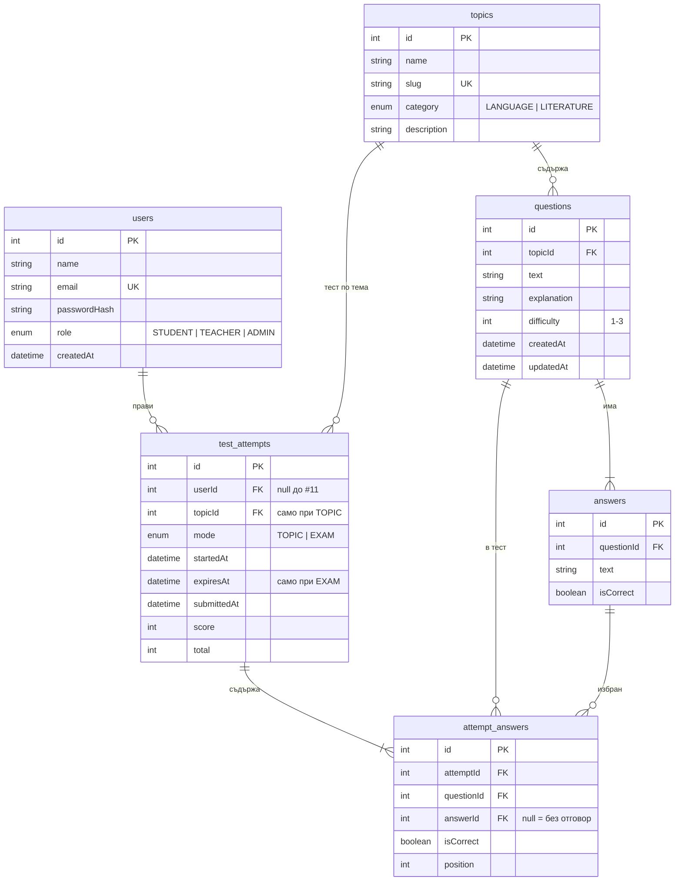

# ER диаграма на базата (issue #10)

Схемата е в `server/prisma/schema.prisma`. Диаграмата се показва директно в GitHub.

## Защо е така

- **attempt_answers** пази по един ред за всеки въпрос в теста. Редовете се създават при старт (без отговор) и се попълват при предаване. Така знаем кои въпроси са били в теста, дори ученикът да не е отговорил на всички.
- **isCorrect в attempt_answers** се записва при предаване. Статистиката по теми (#3) се смята с прости заявки, без да се преизчислява всеки тест.
- **userId е незадължително**, докато автентикацията (#11) не е готова. След това трябва да стане задължително.
- При изтриване на въпрос се изтриват и отговорите му (`onDelete: Cascade`).
